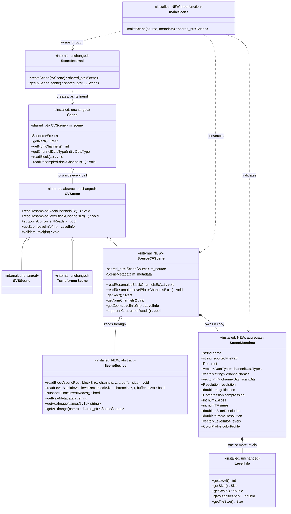
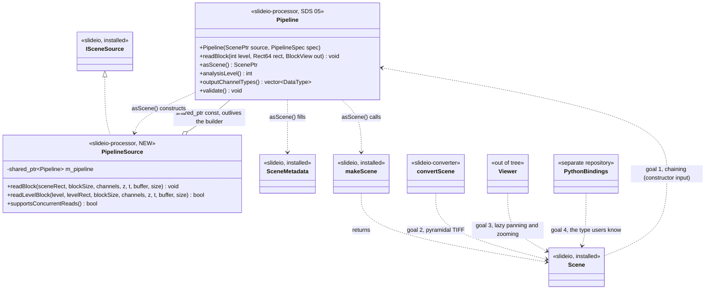

# Scene source — presenting computed rasters as a `slideio::Scene`

**Status:** SlideIO half implemented, merged as
[Booritas/slideio#86](https://github.com/Booritas/slideio/pull/86) on 2026-10-17;
`Pipeline::asScene()` waits on the `pipeline` module
**Date:** 2026-10-08
**Arises from:** [Spike findings, open questions 3 and 4](2026-10-07-spike-q3-q4-findings.md) §1
**Changes:** SlideIO (new public interface) and `slideio-processor` SDS
[05](sds/05-pipeline.md) §5.5
**Resolves:** `requirements.md` open question 3, Assumption 2
**Amended:** 2026-10-17, to match the SlideIO implementation
([Booritas/slideio#86](https://github.com/Booritas/slideio/pull/86)): §3/§4 drop
the export macro from the two header-only types, §3 states the channel-list
contract the source actually sees, §5.1 names `RuntimeError`, §9.1 corrects the
converter's encodings.

A small addition to SlideIO's public surface that lets a consumer present a
computed raster as a genuine `slideio::Scene`, and the `slideio-processor` side
that uses it. It makes `Pipeline::asScene()` implementable without exposing
OpenCV in any installed header.

---

## 1. Intent

### 1.1 What this is for

`project.md` asserts two key decisions. The spike showed they are in conflict:
a library depending only on SlideIO's **public reader API** cannot produce a
`slideio::Scene`, because every seam that would allow it — `cvscene.hpp`,
`sceneinternal.hpp`, `Scene`'s constructor — is deliberately not installed.
`cvscene.hpp` includes `<opencv2/core.hpp>`, and installing it would make
OpenCV a public dependency of SlideIO.

This design resolves the conflict in SlideIO's favour *and* `slideio-processor`'s:
it adds the missing seam in terms that carry no OpenCV, so both decisions hold.

### 1.2 Success criteria

The four goals the result must serve, confirmed with the project owner:

| # | Goal | Met by |
|---|---|---|
| 1 | **Chaining** — a pipeline's output is a valid input to another `Pipeline` (UR-PIX-6) | `asScene()` returns a real `ScenePtr`, which `Pipeline`'s constructor already takes |
| 2 | **Export** — results reach `slideio-converter` for pyramidal TIFF (Assumption 3) | `convertScene()` takes the concrete `Scene` type; see §9.1 for its limits |
| 3 | **Viewing** — a viewer renders results lazily while panning and zooming | Level-explicit reads plus concurrent-read support (§3, §7) |
| 4 | **Python** — bindings expose results as the type users already know | Bindings already wrap `Scene`; only `as_scene()` is new |

### 1.3 The shape of the solution

The object returned **is** a `slideio::Scene` — the concrete class, not a
look-alike. That is the requirement rather than a detail:
`convertScene(std::shared_ptr<Scene>, …)` takes the concrete type, so anything
merely Scene-shaped would be useless to it. What the object is *not* is
file-backed: its pixels come from a consumer-supplied source rather than a
driver.

The mechanism already exists inside SlideIO. `Scene` always delegates to a
`CVScene`; `TransformerScene` is a `CVScene` that computes its blocks instead of
decoding them. **This design adds no new concept. It makes an existing one
reachable from outside the package.**

---

## 2. Design overview

Three new installed declarations and one internal class:

| Piece | Kind | Visibility |
|---|---|---|
| `ISceneSource` | abstract, one pure virtual | **new, installed** |
| `SceneMetadata` | aggregate struct | **new, installed** |
| `makeScene(source, metadata)` | factory function | **new, installed** |
| `SourceCVScene : CVScene` | adapter | new, internal |
| `Scene`, `CVScene`, drivers, transformer | — | **unchanged** |

Responsibilities split along one line: **`SceneMetadata` is what the scene *is*;
`ISceneSource` is how to *read* it.** Static description travels as data, dynamic
behaviour as an interface.

`makeScene` performs no image work. It validates the metadata, constructs the
adapter, and wraps it. Every metadata field is reported verbatim by the
corresponding `Scene` getter — `getRect()` returns `metadata.rect`, it does not
crop to it.

### 2.1 Class diagram — the SlideIO side



Reading it top to bottom: `makeScene` is the only name in the drawing a
consumer calls. It reaches `Scene` through `SceneInternal`, the friend seam that
is not installed and is the reason none of this is reachable today. `Scene`
forwards every call to a `CVScene`, of which `SourceCVScene` is now a third
subclass beside a driver scene and the existing computed one — `SVSScene` and
`TransformerScene` are drawn only to show that the adapter is a sibling of a
kind that already exists, one decoding a file and one computing from another
scene. The two edges leaving `SourceCVScene` are the whole of the new
machinery: it owns a copy of `SceneMetadata` and reads through `ISceneSource`.
`readResampledBlockChannelsEx` is `CVScene`'s sole pure virtual and `readBlock`
is `ISceneSource`'s; every other read on either class is derived from them.

Two notational shortcuts: parameter lists are elided where §3 and §6 give them in
full, and `Rect`/`Size` are unqualified — on `CVScene` and `SourceCVScene` they
are `cv::Rect` and `cv::Size`, which is precisely why those two classes cannot
be installed, and on `Scene`, `ISceneSource` and `SceneMetadata` they are
SlideIO's own OpenCV-free types.

---

## 3. `ISceneSource`

```cpp
// slideio/slideio/scenesource.hpp — installed, no OpenCV
namespace slideio {

class ISceneSource   // header-only interface: no export macro
{
public:
    virtual ~ISceneSource() = default;

    /// Read a rectangle in SCENE coordinates, resampled to blockSize.
    ///
    /// The one method every source must implement. Mirrors
    /// CVScene::readResampledBlockChannelsEx, which is CVScene's own single
    /// pure virtual.
    ///
    /// channelIndices is never empty here: a caller's empty selection means
    /// every channel, in order, and SourceCVScene expands it before calling.
    /// Duplicated indices are permitted; the channel is delivered once per
    /// occurrence, in request order.
    ///
    /// Buffer layout: row-major, channel-interleaved in the order of
    /// channelIndices, rows contiguous with no padding. Its length is
    /// blockSize.width * blockSize.height * n * elementSize, with n the number
    /// of channels requested.
    ///
    /// Every requested channel must share one data type. A cv::Mat carries a
    /// single depth for all of its channels, so a mixed-type request cannot be
    /// expressed at all; SourceCVScene rejects one before calling here (6.1).
    /// A scene whose channels differ in type is read one channel per call.
    ///
    /// sceneRect is NOT clamped. SlideIO forwards it exactly as the caller
    /// gave it, so any part outside the scene is the source's own to fill with
    /// the background value.
    ///
    /// Throws on any failure; never reports an error by partial fill.
    virtual void readBlock(const Rect& sceneRect,
                           const Size& blockSize,
                           const std::vector<int>& channelIndices,
                           int zSlice, int tFrame,
                           void* buffer, size_t bufferSize) = 0;

    /// Read from an explicitly named pyramid level, in LEVEL coordinates.
    ///
    /// Return false — the default — to let SlideIO derive the read from
    /// readBlock() by scaling through LevelInfo::getScale(), which is what
    /// CVScene does for single-level drivers. Override and return true when the
    /// source has a real pyramid and reading the named level directly avoids
    /// rounding twice.
    ///
    /// The two paths differ in who clamps. Declining hands the read to
    /// CVScene::readClampedBlock, which clips levelRect to the level bounds,
    /// fills the remainder with the background value and calls readBlock()
    /// with the surviving part mapped into scene coordinates. Overriding gets
    /// levelRect unclamped, so a source that implements this owns its own
    /// bounds handling.
    ///
    /// Buffer layout is readBlock()'s, including the one-data-type rule.
    virtual bool readLevelBlock(int level,
                                const Rect& levelRect,
                                const Size& blockSize,
                                const std::vector<int>& channelIndices,
                                int zSlice, int tFrame,
                                void* buffer, size_t bufferSize) { return false; }

    /// Whether reads of one source may overlap. False — the default — makes
    /// SlideIO serialise them, matching CVScene::supportsConcurrentReads().
    virtual bool supportsConcurrentReads() const { return false; }

    /// Rare and lazy; defaulted so a minimal source implements neither.
    virtual std::string getRawMetadata() const { return {}; }
    virtual std::list<std::string> getAuxImageNames() const { return {}; }
    virtual std::shared_ptr<ISceneSource> getAuxImage(const std::string&) const {
        return nullptr;
    }
};

} // namespace slideio
```

**One required method.** This mirrors `CVScene` exactly: its only pure virtual
is `readResampledBlockChannelsEx`, in scene coordinates, and
`readResampledLevelBlockChannelsEx` carries a default that clamps the level
rectangle, maps it through `LevelInfo::getScale()` and delegates down. Every
other public read overload — eleven of them — is derived from those two by
`CVScene`'s existing funnelling, including the 4D range forms, which
`assemble4DBlock` loops into single-plane calls. A source implementing
`readBlock` alone gets all of them working.

**Two contracts the comments now carry, both measured rather than assumed.**

*One data type per multi-channel read.* `cv::Mat` has a single depth for all of
its channels, so no interleaved buffer can hold a `Byte` channel beside a
`Float32` one. This is SlideIO's model, not a limit this design adds, and it
costs nothing in reach: a mixed-type scene is read one channel per call and
every channel comes back losslessly.

*Clamping is asymmetric, and only one of the two paths does it.*
`readClampedBlock` is reached solely from the base
`readResampledLevelBlockChannelsEx` (`cvscene.cpp:233`); the scene-coordinate
funnel forwards its rectangle untouched (`cvscene.cpp:177`). So a source that
declines `readLevelBlock` is clamped and background-filled for it, and a source
that implements it is not. Stating that in the header is what keeps a correct
source from producing subtly wrong edge tiles.

`readLevelBlock` returning `bool` rather than being pure keeps the minimal case
minimal while letting a source with a genuine pyramid — `Pipeline` has one — take
the direct path. `slideio-processor` overrides it.

---

## 4. `SceneMetadata`

```cpp
// slideio/slideio/scenemetadata.hpp — installed, no OpenCV
namespace slideio {

struct SceneMetadata   // header-only aggregate: no export macro
{
    std::string              name;                 // Scene::getName()
    std::string              reportedFilePath;     // Scene::getFilePath(); may be empty
    Rect                     rect;                 // Scene::getRect()
    std::vector<DataType>    channelDataTypes;     // size defines getNumChannels()
    std::vector<std::string> channelNames;         // empty, or one per channel
    std::vector<int>         channelSignificantBits;  // empty, or one per channel
    Resolution               resolution{0.0, 0.0};
    double                   magnification   = 0.0;
    Compression              compression     = Compression::Uncompressed;
    int                      numZSlices      = 1;
    int                      numTFrames      = 1;
    double                   zSliceResolution = 0.0;
    double                   tFrameResolution = 0.0;
    std::vector<LevelInfo>   levels;               // the pyramid; at least one
    ColorProfile             colorProfile;         // empty means none
};

} // namespace slideio
```

Every field answers a `Scene` getter that must return *something*. The struct is
not a request; it is a declaration.

`reportedFilePath` is named for what it does, because `filePath` in a struct
handed to a function called `makeScene` reads as "open this." A computed scene
has no file. `slideio-processor` sets it to the originating slide's path or
leaves it empty.

**`LevelInfo` is the right type for the pyramid and needs no new work.** It is
already installed, concrete, copyable, and publicly constructible —
`LevelInfo(level, size, scale, magnification, tileSize)` — with setters and a
computed tile grid. The adapter owns copies, exactly as a driver-backed scene
owns the `LevelInfo` objects `getLevelInfo()` returns pointers to. A
single-level source passes one entry with scale 1.

---

## 5. `makeScene`

```cpp
// slideio/slideio/scenesource.hpp — installed
std::shared_ptr<Scene> SLIDEIO_EXPORTS makeScene(std::shared_ptr<ISceneSource> source,
                                                 const SceneMetadata& metadata);
```

Validates, constructs a `SourceCVScene`, and returns
`SceneInternal::createScene(adapter)`. No pixels are read and no I/O occurs.

### 5.1 What it validates

Validation is at construction, deliberately. The alternative is a malformed
scene failing at its first tile read — which for this project means after a
long run has already started.

`makeScene` throws `slideio::RuntimeError`, naming the field, when (SlideIO
has no `InvalidArgumentError`; every SlideIO API raises `RuntimeError`):

| Condition |
|---|
| `source` is null |
| `channelDataTypes` is empty, or contains `DT_Unknown` / `DT_None` |
| `channelNames` or `channelSignificantBits` is non-empty and its size differs from `channelDataTypes` |
| `rect` has width or height ≤ 0 |
| `levels` is empty |
| `levels[0].getScale() != 1.0` (within tolerance), or its size differs from `rect`'s |
| any level has a non-positive size, a non-positive scale, or a negative tile dimension |
| level scales are not strictly decreasing with index |
| `numZSlices < 1` or `numTFrames < 1` |

### 5.2 What it trusts

That `readBlock` honours its contract — fills the buffer, respects
`blockSize` and the declared channel types. This cannot be checked up front.
Debug builds assert the buffer size the adapter computed matches what the
source was given; release builds do not.

---

## 6. `SourceCVScene` — the adapter

Internal, in `slideio/slideio/` next to `sceneinternal.hpp`. Not installed.

```cpp
class SourceCVScene : public CVScene
{
public:
    SourceCVScene(std::shared_ptr<ISceneSource>, SceneMetadata);

    // metadata, answered from the stored struct
    cv::Rect getRect() const override;              // from metadata.rect
    int      getNumChannels() const override;       // channelDataTypes.size()
    DataType getChannelDataType(int) const override;
    // ... name, resolution, magnification, compression, z/t, colour profile

    int getNumZoomLevels() const override;
    const LevelInfo* getZoomLevelInfo(int level) const override;  // owned copies

    bool supportsConcurrentReads() const override;  // from the source

    // the pure virtual, forwarded
    void readResampledBlockChannelsEx(const cv::Rect&, const cv::Size&,
        const std::vector<int>&, int zSlice, int tFrame, cv::OutputArray) override;

    // overridden so a source with a real pyramid is asked directly
    void readResampledLevelBlockChannelsEx(int level, const cv::Rect&, const cv::Size&,
        const std::vector<int>&, int zSlice, int tFrame, cv::OutputArray) override;
};
```

Both read overrides do the same three steps: size and allocate the `cv::Mat`
from `blockSize`, the channel selection and the declared data type; call the
source with `mat.data` and `mat.total() * mat.elemSize()`; hand the result to
`output`. `readResampledLevelBlockChannelsEx` first calls
`source->readLevelBlock(...)` and, if it returns false, delegates to
`CVScene::readResampledLevelBlockChannelsEx` — the base implementation — which
maps the level rectangle to scene coordinates and comes back through the pure
virtual.

### 6.1 The adapter checks the channel types, because the base class does not

`cv::Mat` holds one depth for every channel it carries, so a block spanning a
`Byte` channel and a `Float32` one cannot be built at all. An earlier draft of
this document said the base class already rejected that. **It does not.**
Before PR #86, `CVScene::initializeSceneBlock` took channel **0**'s type
unconditionally — not even the type of the channels the caller asked for — and
sized the block from it, so asking a scene whose channel 0 is `Byte` for
channels {3, 4} of type `Float32` silently returned a `Byte` block.

PR #86 fixed half of that. The block is now typed by the first channel
requested (`CVScene::blockDataType`, `cvscene.cpp:343`), so a same-type request
on channels other than 0 is correct for every driver. A request that *mixes*
types — {0: `Byte`, 3: `Float32`} — is still accepted by the base class and
every driver, and comes back typed by its first channel. That remaining gap is
a pre-existing SlideIO defect, listed in §12 and filed as
[Booritas/slideio#90](https://github.com/Booritas/slideio/issues/90).

For this adapter it is not merely wrong but unsafe. `SourceCVScene` computes
the buffer length it passes to the source from the `cv::Mat` it allocated, so a
block sized by channel 0's type and filled for channels of a wider one would
overrun the buffer by the ratio of the two element sizes — heap corruption
rather than a diagnostic.

So `SourceCVScene` allocates from **the declared type of the requested
channels** and throws `RuntimeError` naming each channel and its type when they
do not agree. That is deliberately stricter than its siblings: the alternative
is to reproduce a known defect for symmetry's sake. Reading such a scene one
channel per call succeeds and loses nothing.

---

## 7. `Pipeline::asScene()` — the consumer side

SDS 05 §5.5 keeps its signature. Only the implementation is newly possible.



The cycle is the point: `Pipeline` produces a `Scene` and `Pipeline`'s
constructor consumes one, which is UR-PIX-6 with no new type in between.
`PipelineSource` holds the pipeline by `shared_ptr<const Pipeline>` (the diagram
elides the `const`), so the three consumers along the bottom may outlive
whatever built the scene.

```cpp
class PipelineSource : public slideio::ISceneSource {
public:
    explicit PipelineSource(std::shared_ptr<const Pipeline> p) : m_pipeline(std::move(p)) {}

    void readBlock(const Rect& sceneRect, const Size& blockSize,
                   const std::vector<int>& channels, int z, int t,
                   void* buffer, size_t bufferSize) override {
        fill(m_pipeline->analysisLevel(), toRect64(sceneRect),
             blockSize, channels, z, t, buffer, bufferSize);
    }

    bool readLevelBlock(int level, const Rect& levelRect, const Size& blockSize,
                        const std::vector<int>& channels, int z, int t,
                        void* buffer, size_t bufferSize) override {
        fill(level, toRect64(levelRect), blockSize, channels, z, t, buffer, bufferSize);
        return true;                                              // real pyramid
    }

    bool supportsConcurrentReads() const override { return true; }   // SDS 05 §5.5

private:
    /// Compute planar, deliver interleaved.
    void fill(int32_t level, const Rect64& rect, const Size& blockSize,
              const std::vector<int>& channels, int z, int t,
              void* buffer, size_t bufferSize) const {
        if (z != 0 || t != 0)                     // metadata declares 1 of each
            throw InvalidArgumentError(...);
        const DataType type = uniformTypeOf(channels);   // throws if they differ

        // The pipeline's own output buffers: one plane per requested channel,
        // which is the only layout that can carry UR-IMG-9's mixed types and
        // the layout every Operation indexes (01-core.md 1.8).
        PlaneBuffers planes(blockSize, channels, type);  // budgeted, reused
        BlockView out(blockSize.width, blockSize.height,
                      toLevel0(rect, level), level,
                      planes.descriptors(), planes.count());

        m_pipeline->readBlock(level, rect, out);         // SDS 05 §5.5

        interleaveInto(buffer, bufferSize, out, channels);
    }

    std::shared_ptr<const Pipeline> m_pipeline;
};

slideio::ScenePtr Pipeline::asScene() const {
    validate();                                   // types and arity, before any pixel
    slideio::SceneMetadata m;
    m.rect             = toRect(rect(analysisLevel()));
    m.channelDataTypes = outputChannelTypes();    // computed by validate()
    m.levels           = buildLevels();           // from LevelSelector, §5.6
    m.resolution       = sourceResolution();
    m.magnification    = sourceMagnification();
    m.name             = "pipeline";
    return slideio::makeScene(std::make_shared<PipelineSource>(shared_from_this()), m);
}
```

**The pipeline computes planar and delivers interleaved, and `PipelineSource`
is where the two layouts meet.** `BlockView` is planar with a `DataType` per
plane — the only layout that can carry a scene mixing `Byte` and `Float32`
channels (`01-core.md` 1.8) — while `ISceneSource` hands over one interleaved
buffer of one type, because that is what a `cv::Mat` is. An earlier draft of
this section wrote `BlockView out(buffer, bufferSize, blockSize, channels)`,
which assumed a planar view could simply be laid over an interleaved buffer.
It cannot, and no constructor can make it so.

Three places could hold the conversion, and the choice is not arbitrary:

| Where | Why not |
|---|---|
| A pixel stride on `BlockPlane`, so planes alias one interleaved buffer | `cv::Mat` expresses a row stride but **not** an element stride within a row, so an aliased plane cannot be wrapped without a copy — and every `algorithm` operation is OpenCV-backed. The copy reappears inside the pipeline, and every operation author pays for a stride case that arises at one boundary |
| A planar `ISceneSource` | Moves the same copy into SlideIO and pushes this project's idiom into SlideIO's public API, where every other scene is interleaved |
| **`PipelineSource`** | `pipeline` is the module that links OpenCV, so the merge belongs here |

**This costs nothing over what §9.2 already names.** The pipeline must
allocate planar output buffers regardless — its operations index them — and
the interleave writes those planes into the caller's buffer in one pass. That
pass *is* the copy §9.2 describes, not a second one.

Two guards the sketch makes explicit. `uniformTypeOf` throws when the request
spans data types, which cannot happen through `SourceCVScene` (6.1) but can if
a future caller holds the source directly. And non-zero `z` or `t` is rejected
rather than ignored, since the metadata declares one slice and one frame.
Merging follows the order of `channelIndices`, so a reordered or subset request
like {2, 0} comes back in the order asked — which is what
`BlockPlane::sourceChannel` exists to make unambiguous.

Three things worth noting. The source holds a `shared_ptr<const Pipeline>`, so a
returned scene outliving the caller's handle is safe — a viewer will hold one
far longer than the code that built it. `supportsConcurrentReads()` returns true
because SDS 05 already promises the scene is ThreadSafe for reads; without the
override SlideIO would serialise every viewer read. And `validate()` runs first,
so a mis-specified pipeline fails at `asScene()` rather than at the first tile.

`Pipeline`'s constructor is unchanged: it takes `slideio::ScenePtr` and always
did. Chaining works because `asScene()` now returns one.

---

## 8. Design decisions

**One required read method, in scene coordinates.** Settled by reading
`CVScene`: its only pure virtual is the scene-coordinate `…Ex` read, and the
level-based one has a base implementation built on it. Requiring a level-based
method instead would invert that and force every simple source to implement
level mapping it does not have. The optional `readLevelBlock` returning `bool`
gives a real pyramid the direct path without taxing a source that has none.

**Metadata as a struct, not as virtuals.** A fat `ISceneSource` answering
`getName`, `getResolution`, `getMagnification` and twenty more would deliver
static values through a vtable, force every consumer to override a pile of
methods, and make the ABI brittle — adding one virtual later breaks it. A struct
also lets `makeScene` validate everything in one pass at construction.

**A plain aggregate, accepting the ABI consequence.** Adding a field changes the
struct's size and breaks binary compatibility, so new fields land only at a
major version. The alternatives — a leading `structSize`, or a pimpl with
setters — buy evolution at the cost of ergonomics, and SlideIO already ships
`LevelInfo` as a public value type with inline member access, which is an ABI
commitment of exactly the same kind. Consistency with existing practice wins.
Open question 2 (pinning the SlideIO version) covers the residual risk.

---

## 9. Known constraints

### 9.1 The converter is narrower than the pipeline

Confirmed by reading `tiffconverter.cpp`, and **not caused by this design** —
these limits apply to any `Scene` handed to `convertScene` today.

| Constraint | Evidence |
|---|---|
| Float output is declared | `DT_Float32 → "float"`, `DT_Float64 → "double"` (`:221`) |
| JPEG and JPEG 2000 are the only encodings offered; there is no uncompressed option | `ConverterParameters` raises "Unsupported compression type" for anything else (`converterparameters.cpp:23-31`) |
| JPEG requires 8-bit on every channel | `checkJpegRequirements` (`tiffconverter.cpp:940`) |
| JPEG 2000 has no 8-bit check in the converter | `checkEncodingRequirements` only checks JPEG (`tiffconverter.cpp:956`) |
| SVS rejects a scene with mixed channel types, whatever channel range is set | `checkSVSRequirements` checks every channel of the scene (`tiffconverter.cpp:957`) |
| OME-TIFF rejects a channel range of mixed types (since PR #86) | `checkOMETIFFRequirements` checks the range set by `ConverterParameters::setChannelRange` |
| Output formats are SVS and OME-TIFF only | `ImageFormat` |

*Corrected 2026-10-17.* An earlier version of this section said a float result
writes uncompressed. It does not: the converter offers no uncompressed
encoding. A non-8-bit result can only go out as JPEG 2000. Whether the JPEG 2000
encoder handles `Float32` correctly is **not verified**; the SlideIO end-to-end
test (`test_sourcescene_conversion.cpp`) exercises only 8-bit data through
lossless JPEG 2000. And UR-IMG-9 permits mixed channel types that neither
format accepts in one file. OME-TIFF takes them one same-type channel range per
file, set with `ConverterParameters::setChannelRange`; SVS does not take them at
all, since its check ignores the range (§13, question 1).

The converter also needed one change for computed scenes. `TiffConverter`
re-opened every scene by file path in each reader thread, which a computed
scene cannot survive. It now shares a scene whose driver id is
`SourceCVScene::DRIVER_ID` (`"SOURCE"`) instead of re-opening it, and a re-open
failure raises an exception rather than terminating the process.

**Assumption 3 — "slideio-converter is available for writing pyramidal TIFF" —
is narrower than it reads** and should be amended to say for what.

### 9.2 A buffer copy per block

The adapter materialises a `cv::Mat` and hands its buffer to the source, so each
block crosses the boundary once more than a driver-backed read would. Measurable,
and avoidable later by letting a source write into a caller-provided buffer
without the intermediate — but not worth designing around before it is measured.

For a `Pipeline` source this pass is also where planar output becomes
interleaved (§7), so the interleave is folded into the copy rather than added
to it.

### 9.3 `getBlockSize` remains 32-bit

`Scene::getBlockSize` computes in 32-bit `int` (spike findings §3.1), so a block
above 2 GB — about 13,000² at 3 × `Float32` — overflows. Unaffected by this
design, and a bound on how large a block a consumer of the returned scene may
request.

### 9.4 Recomputation on every read

A viewer panning back over a region recomputes the pipeline. Caching belongs to
the viewer, not here, but it is the difference between interactive and unusable.

### 9.5 One data type per multi-channel read

A single `readBlock` call delivers one interleaved buffer of one data type, so
a scene whose channels differ in type is read one channel per call. The
restriction is `cv::Mat`'s and applies to every SlideIO scene, not just a
computed one. The base class types a block by its first requested channel,
but does not reject a request that mixes types; `SourceCVScene` does, instead
of returning a block of the wrong type (6.1).

Nothing is lost. Every channel reads back losslessly one at a time, so a
`Pipeline` whose output channels differ in type still reaches a viewer, a
converter and Python — each of them simply issues one read per channel.
`SceneMetadata::channelDataTypes` declares the true per-channel types, so a
consumer can see the mix before it reads and group its requests by type.

What this does bound is `convertScene` (§9.1). SVS rejects a mixed-type scene
outright. OME-TIFF rejects a mixed-type channel range (§13, question 1), so such
a scene exports to OME-TIFF one same-type channel range per file.

---

## 10. Testing

**SlideIO.** A test `ISceneSource` returning a known synthetic pattern, then:
every `Scene` read overload returns the expected pixels, proving the funnelling
(including the 4D range forms and a source that implements only `readBlock`);
each metadata getter returns its declared value verbatim; `makeScene` throws for
every condition in §5.1; a source with `readLevelBlock` returning true is asked
directly, and one returning false is served through the scaling path, with both
producing the same pixels for a level-0 read; `supportsConcurrentReads() == true`
permits overlapping reads and `false` serialises them; and the returned scene
passes `convertScene` to a readable TIFF.

Three tests exist because of 6.1 and the clamping asymmetry. A scene declaring
mixed channel types is read one channel at a time and every channel comes back
losslessly, while a request spanning two types throws naming both channels and
their types rather than returning a block. A source that declines
`readLevelBlock` and is asked for a rectangle straddling a level edge receives
a clamped scene rectangle, and the region outside is background-filled by
`CVScene`; a source that implements it receives the same rectangle unclamped.

**slideio-processor.** `asScene()` computes no pixels at construction, shown by
instrumentation, which is UR-EXE-1's existing acceptance criterion; a
three-operation chain read through the scene matches the same chain run eagerly,
byte for byte; the scene survives its builder going out of scope; and a pipeline
scene fed to another `Pipeline` produces the same result as the two specs
combined, which is UR-PIX-6.

On the layout boundary (§7): a three-channel block read through the scene is
byte-identical to the pipeline's three planes interleaved by hand, a request
for channels {2, 0} returns them in that order, and a pipeline whose output
channels differ in type is readable channel by channel but throws on a
two-channel request.

---

## 11. Consequences for existing documents

| Document | Change |
|---|---|
| `project.md` | "Raster execution — lazy pipeline exposed as a `Scene`" becomes achievable as stated. No rewrite needed; add a note that it rests on SlideIO's scene-source interface. |
| `requirements.md` Assumption 2 | Rewrite: the `Scene` contract accommodates computed rasters **through `ISceneSource`**, which this project requires SlideIO to provide. |
| `requirements.md` Assumption 3 | Amend per §9.1 — the converter writes uniform-typed scenes as JPEG (8-bit only) or JPEG 2000; it has no uncompressed option, and float through JPEG 2000 is unverified. |
| `requirements.md` open question 3 | Resolve: floats fit, and computed scenes are reachable once this lands. |
| `requirements.md` open question 2 | Minimum SlideIO version must now be at or after the release carrying `ISceneSource`. |
| SDS 05 §5.5 | `asScene()` unchanged in signature; add the implementation sketch and the concurrency note. |
| SDS 00 | If `ISceneSource` appears in any `slideio-processor` public header, record the SlideIO version it requires. |
| SlideIO `BREAKING_CHANGES.md` | Not a break — additive only. A release note naming the new public surface. |

---

## 12. Out of scope

**An open `Transformation`.** Making SlideIO's transformer accept
consumer-defined operations is a worthwhile feature and was considered. It is
the wrong layer here: `TransformerScene` drives the tiling, where
`slideio-processor` owns tiling, halo supply, memory budget, seam merging and
level selection (SDS 05 §5.6–5.9); and a `Transformation` maps blocks to blocks,
so it cannot express operations that emit objects. Worth doing on its own merits,
with its own design.

**Rejecting mixed-type block requests in the base class** (6.1). Every driver
other than `SourceCVScene` still returns a block typed by the first requested
channel for a request that mixes types. **Filed** as
[Booritas/slideio#90](https://github.com/Booritas/slideio/issues/90). The
related channel-0 assumption in `initializeSceneBlock` was brought into scope
and fixed in PR #86: a block is now typed by the first channel requested.

**Fixing the undiagnosed downcast** in `makeTransformationCopy` (spike findings
§1.2), which silently substitutes a different operation for a consumer-defined
`Transformation`. A separate defect, unaffected by this work and still worth a
fix, since the public `Transformation` base remains misusable. **Filed** as
[Booritas/slideio#89](https://github.com/Booritas/slideio/issues/89).

**A 64-bit `getBlockSize`**, and the other 32-bit boundaries in §9.3.

---

## 13. Open

1. ~~Does OME-TIFF accept mixed channel data types, by splitting channel ranges
   into separate directories?~~ **Closed: no.** One OME-XML `Pixels` element
   states one type, so PR #86 makes `convertScene` reject a mixed-type OME-TIFF
   channel range. Export one same-type range per file to OME-TIFF (§9.1). SVS
   is stricter: it rejects any scene with mixed channel types, whatever range
   is set.
2. Which repository owns this document. It specifies a SlideIO change but arose
   from `slideio-processor`'s requirements; it currently lives here, and the
   SlideIO side may want its own copy or an issue referencing it.
