# SDS — Class diagrams

**Status:** draft for review
**Date:** 2026-10-08
**Parent:** [SDS README](README.md)

The classes of all seven modules, drawn. Nothing here is new: every class,
member and relationship comes from [01](01-core.md)–[07](07-reporting.md), and
where a drawing and a module document disagree, **the module document is
correct**. This exists to make the shape visible before the detail — which
classes there are, which own which, and which of them cross a module boundary.

---

## Notation

| In the drawings | Means |
|---|---|
| `<<ThreadSafe>>`, `<<Immutable>>`, `<<ThreadCompatible>>`, `<<ThreadConfined>>` | the class's C-7 thread-safety level, which every public class carries exactly one of |
| `<<interface>>` | abstract base with pure virtuals; the level follows it where the module states one |
| `<<enumeration>>`, `<<POD>>`, `<<free functions>>` | an `enum class : int32_t` (C-2), a plain struct exempt from pimpl, a header of non-member functions |
| `cstr`, `voidptr`, `bytes` | `const char*` (UTF-8, with C-4's lifetime rules), `void*` and `uint8_t*`. Written as aliases because a Mermaid member line ending in `*` has the star eaten as its abstract-method marker |
| `◆──` filled diamond | composition: the owner's lifetime governs |
| `◇──` open diamond | aggregation: shared or borrowed, typically a `shared_ptr` or a reference to a parent-owned sub-object |
| `··>` dashed | depends on, calls, or returns |
| `──▷` hollow triangle | realizes an interface |

Members are the defining ones, not all of them. Parameter lists are shortened
where the module document gives them in full. Overloads appear once.

**What the drawings deliberately omit:** constructors, destructors, copy and
move members, `count()`/`at()` accessor pairs where they are the C-5 collection
convention rather than anything structural, and every `Ptr` alias (`StorePtr`,
`CursorPtr`, …), which C-2 declares next to each handle type.

---

## D.1 The seven modules

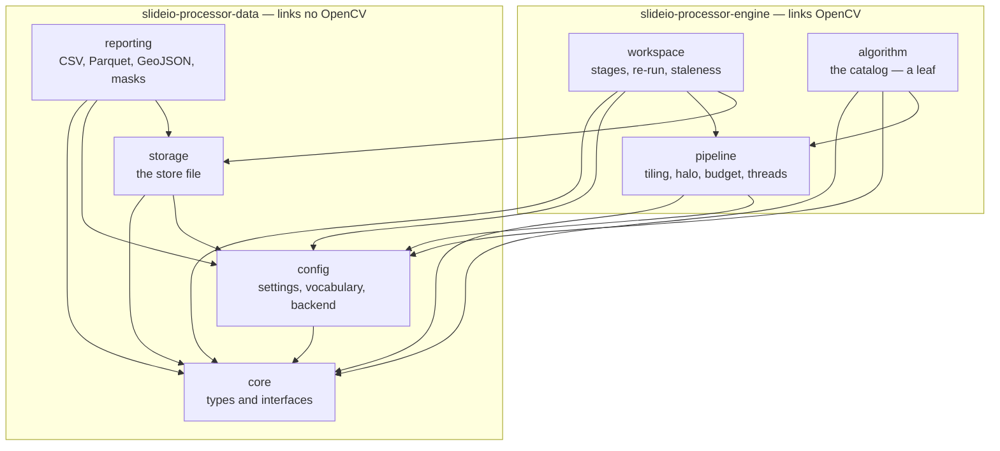

`storage` additionally depends on **SlideIO**, for raster I/O only: a
persisted raster is a pyramidal TIFF beside the store (`03-storage.md` 3.8),
and reading one back is SlideIO opening it. That is a module edge, not a
library one — the data library already links SlideIO through `reporting`'s
`MaskWriter`. The alternative home was `reporting`, which fails because
`workspace` does not depend on it and must not start to; persistence with
attribution and discard is `storage`'s subject, while `reporting` exports
finished results.

An arrow is *depends on*. Three absences carry the design:

- **`algorithm` is a leaf** — nothing points at it. `workspace` resolves
  operations by name through `pipeline::OperationCatalog`, so the catalog's
  contents can change without touching anything above it (design 4), which is
  what let the v1 catalog be settled last and what keeps v1.1 additions free
  (`06-algorithm.md` 6.10).
- **`algorithm` never reaches `storage`.** An operation emits into
  `core::ObjectSink` and never sees a database, so transaction and batching
  discipline exists in one implementation no algorithm author can bypass.
- **`pipeline` never reaches `storage`** either, which is why
  `restrictToLayer` cannot live on `PipelineSpec` — resolving a layer to a
  region needs a store.

The boxed split is the library split: a viewer links the lower box and loads no
OpenCV.

---

## D.2 `core`

Four drawings: values, errors, the flow interfaces, and the services. `core`
holds no state and performs no I/O beyond the GeoJSON codec.

### D.2.1 Values and identity

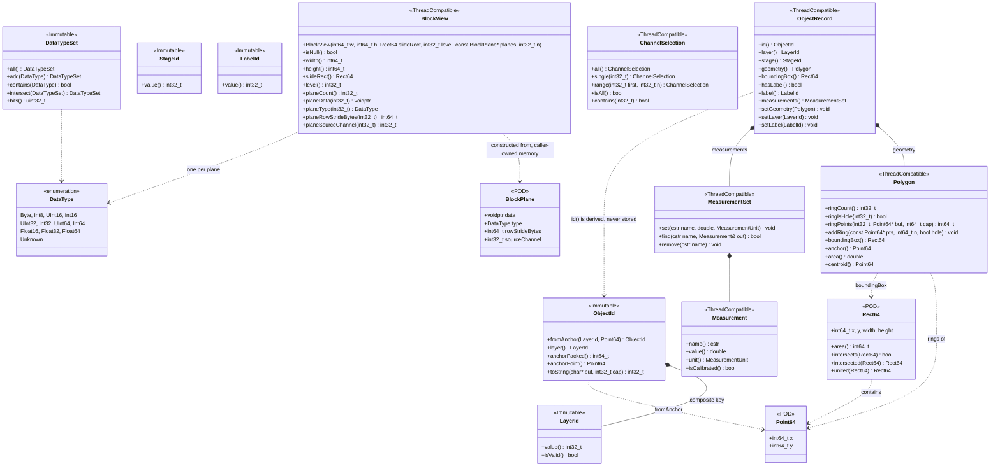

Two relationships here decide more than they look like they do.

`ObjectRecord ··> ObjectId` is dashed because `id()` is **computed**, not held:
it is `ObjectId::fromAnchor(layer(), geometry().anchor())`, so setting the
geometry changes the identifier. That is the whole of decision 8 — identity is
position — and it is what makes results byte-identical across worker counts and
tile sizes (UR-QA-3). `Polygon::anchor()` is therefore part of the store
format's stability contract, not an implementation detail.

`ObjectRecord` has no `setStage` and no parent accessor, and both absences are
load-bearing: the stage is stamped by the writer that emits the record
(`03-storage.md` 3.5), and the parent is a separate edge record so an object can
be attached after it was written (UR-RES-4).

`BlockView` is planar — one plane per selected channel, each with its own
`DataType` — which is what lets a scene mixing `Byte` and `Float32` be
processed without special-casing (UR-IMG-9), and what gives NumPy a zero-copy
view (UR-API-3). `width()` is in level pixels while `slideRect()` is in level-0
coordinates; the two disagree by the level's scale whenever `level() > 0`, by
design.

### D.2.2 The error hierarchy

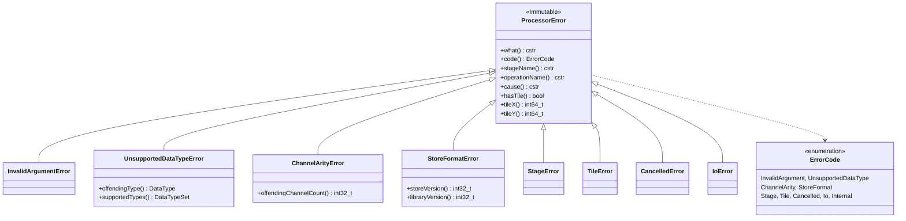

**The hierarchy is closed.** UR-API-5 requires that nothing else escape a
public boundary, so every module catches SQLite, OpenCV and standard-library
exceptions and rethrows them as one of these with the original message kept as
`cause()`. The context accessors are UR-EXE-5: a failure names the stage, the
operation and the tile, and fields that do not apply read empty rather than
being absent.

### D.2.3 Flow interfaces — the reason `algorithm` never links `storage`

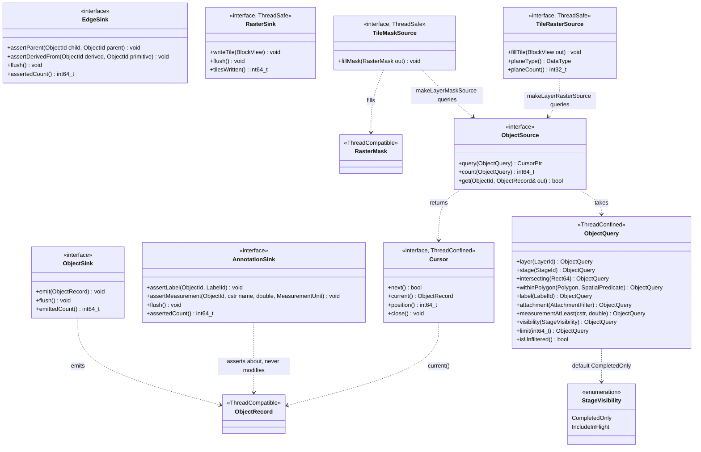

Eight interfaces and one query. `storage` provides implementations of five of
them (D.9); `algorithm` consumes three and links neither SQLite nor `storage`.

`TileRasterSource` is `TileMaskSource` with a value instead of a bit: the
coarse half of a multi-resolution pair, read one tile at a time. Its default
implementation is in `core` for the same reason — it needs an `ObjectSource`,
an `ObjectQuery` and the rasteriser and nothing else.

`AnnotationSink` is shaped after `EdgeSink`, not after `ObjectSink`, and the
resemblance is the design: both assert something *about* an object that
already exists, neither creates or mutates one, and both are undone by
deleting what one stage claimed. That is why a later classification stage needs
no new kind of component — it is an ordinary operation that happens to write
through a different sink (`03-storage.md` 3.7).

`TileMaskSource` is the one whose default implementation *is* in `core`:
`makeLayerMaskSource` needs an `ObjectSource`, an `ObjectQuery` and the
rasteriser, all of which are `core`, so putting it anywhere else would export
a dependency to no purpose. It resolves a restriction one tile at a time,
which is what keeps a restriction to a ten-million-object layer inside the
memory ceiling (`01-core.md` 1.17).

`ObjectQuery` is declared here rather than in `storage` for exactly that
reason: a stage must be able to query earlier stages' objects through
`ObjectSource` (UR-STG-3) without linking the store. Neither sink names a
stage — attribution belongs to the writer behind the interface, so an operation
cannot misattribute what it emits and does not have to know it could.

`visibility()` defaulting to `CompletedOnly` is what makes UR-STG-5 hold by
query filter rather than by rollback: a later stage never sees another's
partial output. An observer opts into `IncludeInFlight` and accepts retraction
(UR-OBS-4).

There is no method anywhere that materialises a result set. UR-RES-6 permits
that only as an explicit, filter-bounded call, and it lives in `reporting`
(D.8).

### D.2.4 Services

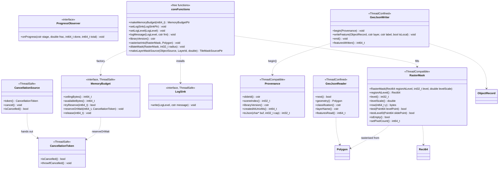

`MemoryBudget` is declared in `core` and nowhere else because UR-EXE-2's
ceiling has to cover raster tiles, object accumulation *and* store buffers
together, while `pipeline` does not depend on `storage`. `workspace`
constructs one instance and hands the same one to both (D.5) — the only
arrangement under which a single ceiling spans both.

One GeoJSON codec, used from both ends by different modules: `storage` holds
the reader for import, `reporting` the writer for export. That placement is why
splitting import from export across two modules does not mean two parsers.
---

## D.3 `config`

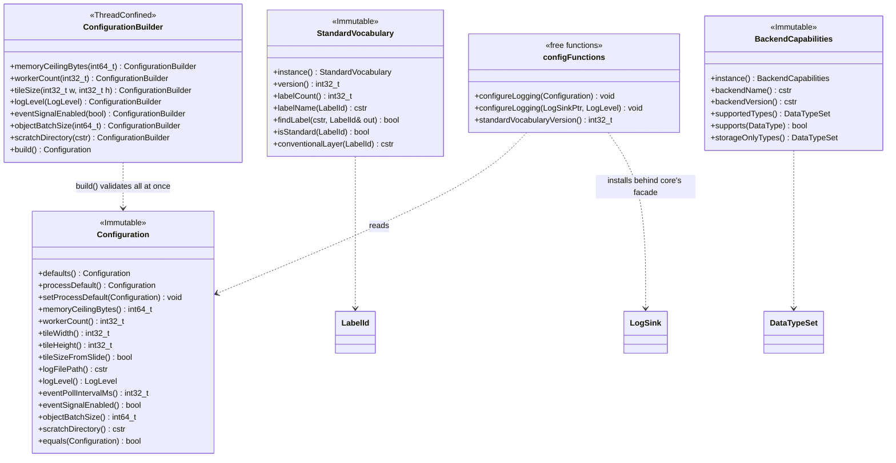

Two singletons and one value. `Configuration` is immutable and **captured by
copy** at construction by every `Workspace`, `Pipeline` and `Store`, so
`setProcessDefault` affects only objects made later — a worker count or tile
size changing mid-run would break UR-QA-3's determinism in a way that
reproduces only intermittently.

The builder/value split that `config` uses here is the one `PipelineSpec`
(D.6) deliberately does *not* use, and 05 §5.4 says why.

`BackendCapabilities::storageOnlyTypes()` is the concrete form of UR-IMG-10
versus UR-IMG-11: the library carries all eleven types losslessly whatever the
backend, and only an *algorithm* may decline one. Under OpenCV 4 the set holds
`UInt32`, `Int64` and `UInt64`; under OpenCV 5 it empties, with no API change.

---

## D.4 `storage`

The largest public surface in the library, and the module a viewer links
without OpenCV. Two drawings: what a `Store` is made of, and the paths that
write to it.

### D.4.1 `Store` and its registries

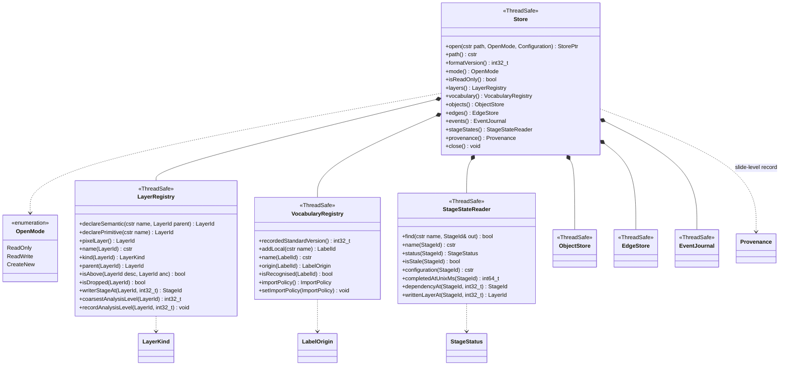

Every sub-object is **owned by the `Store` and handed out by reference**,
valid until `close()` (C-8). A `Store` is `ThreadSafe` throughout: WAL mode,
one connection per accessing thread, which is what lets a `ReadOnly` store in
a viewer process read while a `ReadWrite` store in a script process writes —
UR-OBS-1, measured in the [spike](../2026-10-07-spike-q3-q4-findings.md) §2.3.

`coarsestAnalysisLevel` is how a consumer learns **what a boundary is worth**.
Every polygon is in level-0 coordinates (UR-SEG-4), so a `tissue` layer
detected at level 4 stores integers whose true precision is ±16 level-0
pixels. It is the maximum over all writers, because a layer is only as precise
as its coarsest contributor, and it is what `StageRunner` reads to size its
mask dilation (D.5).

`isAbove` lives here rather than in `workspace` because the containment
ordering constrains edges the store must reject no matter who writes them —
including GeoJSON import and any future external tool.

### D.4.2 The write paths, the journal, and import

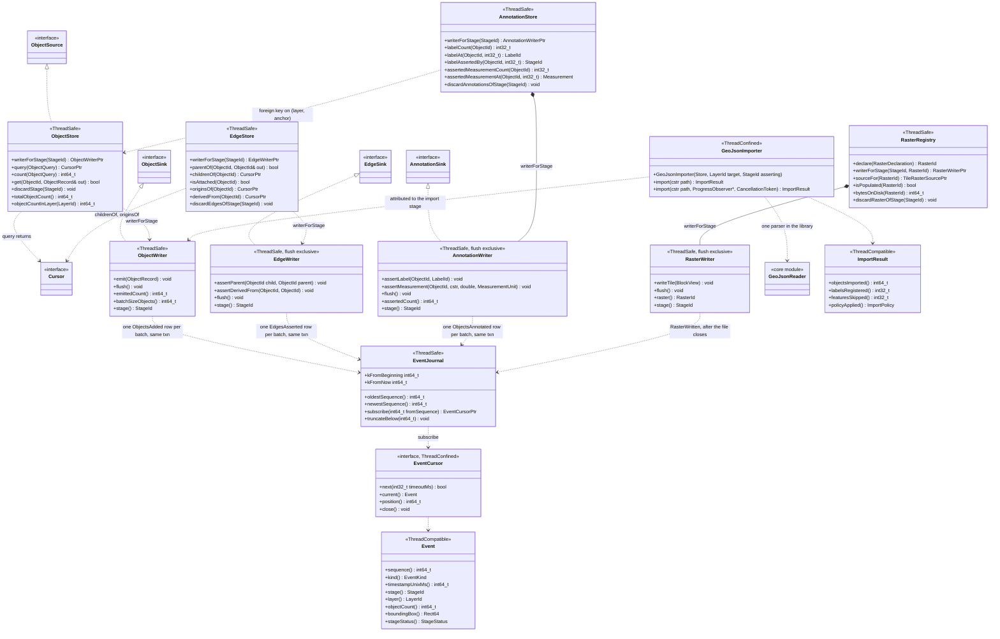

**The writer owns the stage.** `writerForStage(StageId)` is the only way to get
one, and neither `emit` nor `assertParent` takes a stage — so attribution is a
property of the handle a caller was given rather than a value it fills in.
Three guarantees rest on that being unforgeable: `discardStage`,
`discardEdgesOfStage` and `discardAnnotationsOfStage` delete by stage
(UR-STG-6), `CompletedOnly` filters by the asserting stage's status
(UR-STG-5), and UR-STG-4's provenance would otherwise record whatever the
producer asserted.

**The raster path is the exception to everything in this drawing.** Its
pixels are a pyramidal TIFF beside the store, not rows, so its write is a file
followed by a transaction and cannot be atomic with one. `RasterWriter` commits
its row only after the file closes, leaving an unreferenced file rather than a
dangling row on a crash, and `Workspace::open` sweeps those (`03-storage.md`
3.8). Every other arrow here is one transaction.

**Three write paths, one ownership rule, two kinds of delete.** The drawing
now has a writer per table family, and they differ in what a discard destroys.
`discardStage` removes a stage's *objects*, and annotations hanging on them go
too, because the claim loses its subject. `discardEdgesOfStage` and
`discardAnnotationsOfStage` remove a stage's *claims* and leave every object
alone. An annotating stage therefore re-runs without disturbing the layer it
classifies, while re-running the layer's producer invalidates the classifier
through the ordinary `LayerRead` staleness path (D.5).

**Events are rows, not messages.** The dashed arrows from both writers to the
journal are a single transaction each: object rows, R\*Tree rows and one event
row commit together or not at all. A subscriber can never see an event for
objects that are not yet queryable, and nothing appears unannounced — which is
what makes the journal usable as a source of truth (UR-OBS-2) with no publish
step a crash can interrupt. There is no subscriber list, so an extra observer
costs the writer nothing.

Flush order between the writers is not incidental: an edge or an annotation may
name an object still sitting in an unflushed batch, so `EdgeWriter::flush`
verifies both endpoints exist, `AnnotationWriter::flush` verifies its subject
does, and `StageRunner` flushes objects first (D.5).

---

## D.5 `workspace`

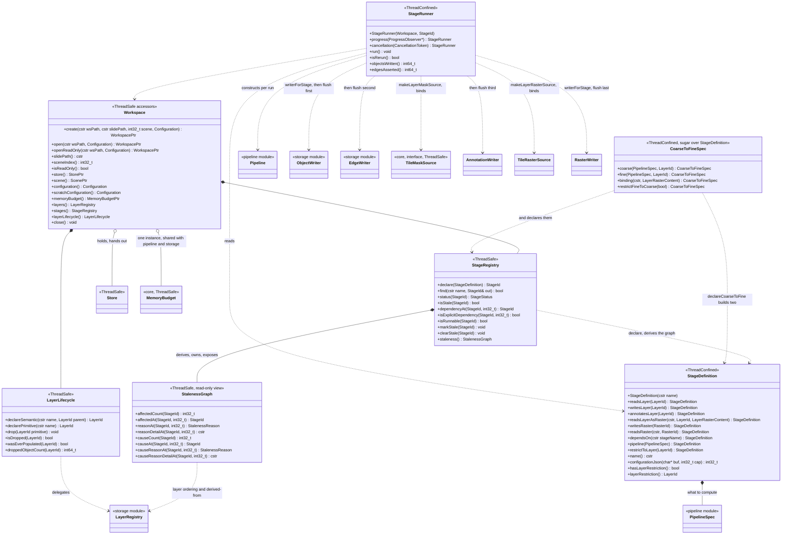

**A stage is a `PipelineSpec` plus the things only a workspace can supply.**
The composition arrow is the whole of that split: the spec is *what to
compute*, a value needing no workspace; `StageDefinition` adds the durable
identity — a name, layer declarations, a layer restriction, explicit ordering —
and every one of those needs a store to mean anything.

**The dependency graph is derived, not declared.** `StageRegistry` computes it
`annotatesLayer` adds no edge of its own: it implies `readsLayer`, so a stage
that classifies a layer depends on the stage that wrote it and goes stale with
it by the path already drawn. It deliberately does *not* imply `writesLayer` —
an annotator contributes no objects to the layer, must not be recorded among
its writers, and must not have `discardStage` called against it on re-run.

Dependencies are derived
from `readsLayer`/`writesLayer`: stage *B* depends on *A* when *A* writes a
layer *B* reads. Recomputed on every `declare`, so a reader declared before its
writer resolves once the writer appears. `dependsOn` survives only for ordering
that is genuinely not a data dependency, and a definition using it where
`readsLayer` would do is a smell.

`StageRunner` is where the modules meet: it binds `restrictToLayer` to a
`TileMaskSource` over that layer — resolved one tile at a time, never as a
whole-slide polygon, because the union of a `cells` layer is gigabytes of
geometry — constructs the `Pipeline`, binds the declared layers by name, wires
the stage's writers, and flushes objects before edges. The restriction is the
one part of a stage that is *bound* rather than *specified*: it cannot live in
`PipelineSpec`, which must serialise and replay from a store alone, so it is
recorded on `StageDefinition` by layer name and bound here as a live object
(`05-pipeline.md` 5.4). It is also the one `MemoryBudget` instance
reaching both `pipeline` and `storage`, which is the only way UR-EXE-2's
ceiling can span raster tiles, object accumulation and store buffers at once.

**`StalenessGraph` is owned by `StageRegistry`, which resolves a gap this
drawing found.** It previously floated unconnected: 04 §4.5 specified the class
but nothing returned one, and it carried mutators (`propagateFrom`,
`requireNoStaleDependents`) overlapping the registry's `markStale` with no
stated boundary. The split is now by authority — the registry owns the durable
flag and is its only writer, the graph is a read-only view that says what a
re-run would invalidate and why a stage is stale, and `staleness()` is how a
caller reaches it.

---

## D.6 `pipeline`

The only module that links OpenCV, and the framework UR-EXT-4 promises. Two
drawings: what an operation is and how a run is specified, then what executes
it.

### D.6.1 The operation contract and the spec

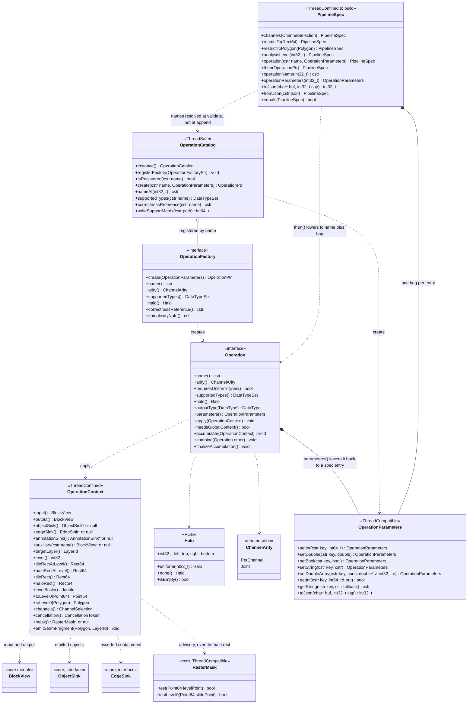

`Operation::parameters()` is the pivot the whole recording story turns on.
Without it a constructed `OperationPtr` is opaque — executable but not
describable — so `then(op)` could not lower to the same entry that
`operation(name, bag)` produces, a pipeline built from typed factories could
never be written to a stage record, and `PipelineSpec::fromJson` would have
nothing to reconstruct. It costs an extension author one stored member, and a
conformance test round-trips every catalog operation through
`create(name(), parameters())`.

`OperationContext` names **both coordinate spaces** — `tileRectAtLevel` versus
`tileRect` — because an operation walks `input()` in level pixels and must emit
in level-0 (UR-SEG-4). `toLevel0` means that conversion has one implementation
rather than one per author: `SeamMerger` joins fragments by exact vertex
coincidence, so two authors rounding differently at a shared seam produce
objects that never join.

`mask()` is **advisory** and the arrow is dashed for that reason. An operation
that reads it skips work it would otherwise do and discard; an operation that
ignores it is still correct, because the framework filters emitted objects
against the same mask downstream of `SeamMerger` (`05-pipeline.md` 5.5).
Correctness is not placed on the extension interface, because UR-EXT-2 lets
anyone implement one and a forgotten check would silently violate UR-STG-3.

The catalog is what keeps `algorithm` a leaf. `workspace` resolves stages
against it by name and never links it, and a user-defined operation registers
exactly as a built-in does (UR-EXT-5).

### D.6.2 Execution

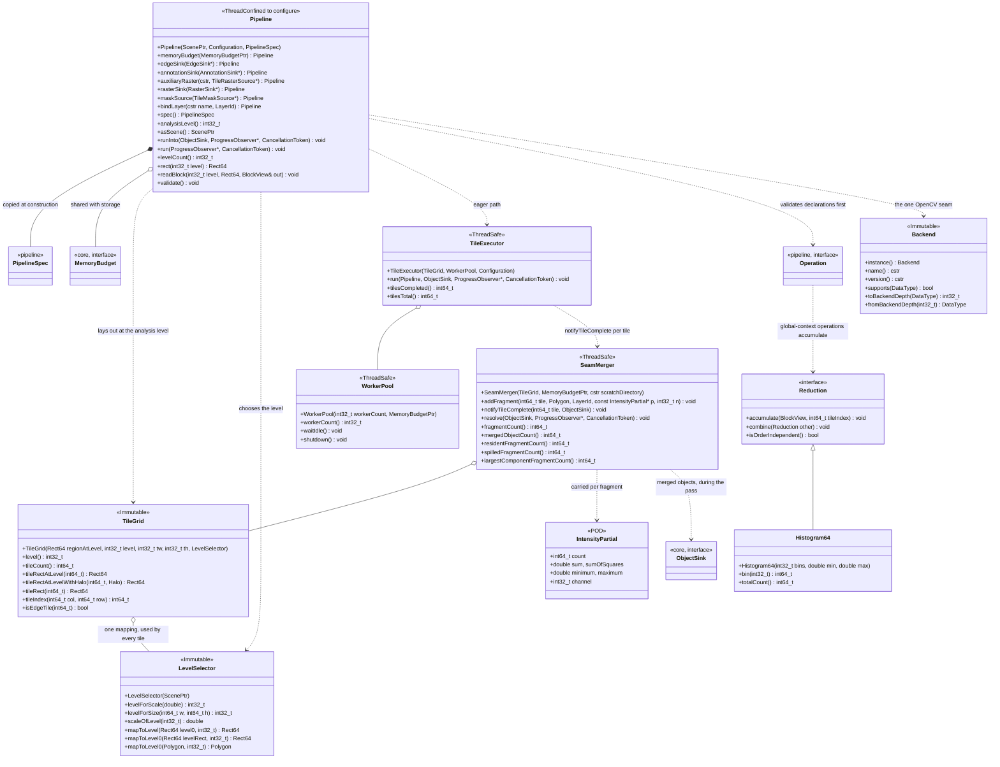

**The grid is laid out at the analysis level, not at level 0**, and
`TileGrid o-- LevelSelector` is why that is safe. Real pyramids are not
obliged to be dyadic — SVS levels routinely report factors like 4.0001 — so a
level-0 tile boundary can land part-way through a level pixel, leaving
adjacent tiles' fragments offset by up to one level pixel after mapping back.
`SeamMerger` keys on **exact** vertex coincidence, so offset fragments never
join: one nucleus becomes two objects, each plausible, with no error raised.
Laying tile boundaries on integers in the space the pixels live in and
deriving the level-0 rectangles from them through one mapping removes the
possibility rather than narrowing it (UR-SEG-3, UR-QA-2, UR-QA-3).

`TileExecutor ··> SeamMerger : notifyTileComplete` is the memory argument. A
component closes as soon as every tile bordering it has completed — it does
not need the pass to finish — so most merged objects are emitted *during* the
tile pass and the resident set is proportional to the frontier of in-flight
tiles rather than to the slide. Held to the end instead, the reference scale
gives ~10⁶ fragments at 700 B–1 KB each: ~700 MB against a 2 GB ceiling, and
roughly double that at 512 px tiles. The test that proves correctness across
three tile sizes is then no longer the test most likely to exhaust memory.

`Reduction::isOrderIndependent()` exists because float addition is not
associative. Integer accumulators return `true` and combine in any order;
float ones return `false` and the framework combines them in canonical tile
order. Placing that rule in the framework rather than in each algorithm is
what makes it enforceable — a float reduction combined in completion order
makes UR-QA-3 fail intermittently and irreproducibly.

`Pipeline::asScene()` returns a `slideio::ScenePtr` and is the lazy path of
UR-EXE-1. It is implementable only through the SlideIO addition specified in
[the scene-source design](../2026-10-08-scene-source-design.md); the spike
found no route to it from the public reader API alone.

---

## D.7 `algorithm`

A leaf: nothing depends on it, and it compiles against public headers only, so
UR-EXT-2 holds for the whole catalog rather than for one demonstration filter.

```mermaid
classDiagram
    direction TB

    class Operation {
        <<pipeline, interface>>
    }
    class OperationParameters {
        <<pipeline>>
    }
    class OperationCatalog {
        <<pipeline, ThreadSafe>>
    }

    class registry {
        <<free functions>>
        +registerBuiltinOperations() void
        +registerPixelOperations() void
        +registerSegmentationOperations() void
        +registerMeasurementOperations() void
    }

    class colourFactories {
        <<free functions>>
        +makeColourConvert(ColourSpace from, ColourSpace to) OperationPtr
        +makeStainDeconvolution(StainVectors) OperationPtr
    }

    class StainVectors {
        +hematoxylinEosin() StainVectors
        +hematoxylinDab() StainVectors
        +setVector(int32_t, double r, double g, double b) void
        +stainName(int32_t) cstr
    }

    class filterFactories {
        <<free functions>>
        +makeGaussianBlur(double sigma, int32_t kernel) OperationPtr
        +makeMedianBlur(int32_t kernel) OperationPtr
        +makeSobel(int32_t dx, int32_t dy, int32_t kernel) OperationPtr
        +makeScharr(int32_t dx, int32_t dy) OperationPtr
        +makeLaplacian(int32_t kernel) OperationPtr
        +makeCanny(double low, double high, int32_t aperture) OperationPtr
        +makeBilateralFilter(int32_t d, double sc, double ss) OperationPtr
        +makeErode(StructuringElement, int32_t n) OperationPtr
        +makeDilate(StructuringElement, int32_t n) OperationPtr
        +makeOpen(StructuringElement, int32_t n) OperationPtr
        +makeClose(StructuringElement, int32_t n) OperationPtr
    }

    class StructuringElement {
        +StructuringElement(StructuringShape, int32_t w, int32_t h)
        +custom(const uint8_t* mask, int32_t w, int32_t h) StructuringElement
    }

    class thresholdFactories {
        <<free functions>>
        +makeFixedThreshold(double, ThresholdDirection) OperationPtr
        +makeOtsuThreshold(ThresholdDirection) OperationPtr
        +makeAdaptiveThreshold(AdaptiveMethod, int32_t block, double offset, ThresholdDirection) OperationPtr
        +makeTypeConvert(DataType, RoundingMode, OverflowMode) OperationPtr
    }

    class segmentFactories {
        <<free functions>>
        +makeTissueDetect(TissueDetectParameters) OperationPtr
        +makeConnectedComponents(ConnectedComponentsParameters) OperationPtr
        +makeContourExtraction(ContourParameters) OperationPtr
    }

    class TissueDetectParameters {
        +saturationThreshold(double) TissueDetectParameters
        +minimumRegionAreaPx(int64_t) TissueDetectParameters
        +closingRadiusPx(int32_t) TissueDetectParameters
        +targetLayer(cstr) TissueDetectParameters
    }

    class ConnectedComponentsParameters {
        +connectivity(Connectivity) ConnectedComponentsParameters
        +minimumAreaPx(int64_t) ConnectedComponentsParameters
        +maximumAreaPx(int64_t) ConnectedComponentsParameters
        +extractHoles(bool) ConnectedComponentsParameters
        +targetLayer(cstr) ConnectedComponentsParameters
    }

    class ContourParameters {
        +includeHoles(bool) ContourParameters
        +targetLayer(cstr) ContourParameters
    }

    class measureFactories {
        <<free functions>>
        +makeObjectMeasurements(MeasurementSelection, ChannelSelection) OperationPtr
        +sceneIsCalibrated(ScenePtr) bool
        +scenePixelSizeMicrons(ScenePtr) double
    }

    class MeasurementSelection {
        +standard() MeasurementSelection
        +geometryOnly() MeasurementSelection
        +add(MeasurementKind) MeasurementSelection
        +contains(MeasurementKind) bool
    }

    registry ..> OperationCatalog : registers every factory
    colourFactories ..> Operation : returns OperationPtr
    filterFactories ..> Operation
    thresholdFactories ..> Operation
    segmentFactories ..> Operation
    measureFactories ..> Operation
    colourFactories ..> StainVectors
    filterFactories ..> StructuringElement
    segmentFactories ..> TissueDetectParameters
    segmentFactories ..> ConnectedComponentsParameters
    segmentFactories ..> ContourParameters
    measureFactories ..> MeasurementSelection
    TissueDetectParameters ..> OperationParameters : targetLayer is setString
    ConnectedComponentsParameters ..> OperationParameters
```

The module is almost entirely free functions, and the single dashed arrow from
`registry` to `OperationCatalog` is its entire coupling to the rest of the
library.

**The two construction paths are byte-identical, not merely equivalent.**
`makeGaussianBlur(2.0, 0)` and `create("pixel.gaussian_blur", bag)` fill the
same `OperationParameters`, so `then(op)` and `operation(name, bag)` append the
identical spec entry and record identically. A factory that computed a value it
did not put in the bag would break that, and the round-trip conformance test is
what catches it.

**The target layer is a name, never a `LayerId`.** An earlier draft took
`LayerId target` as a constructor argument, which broke the name path
outright: the parameter bag holds only int, double, bool, string and
double-array, so every object-producing operation was unconstructible by the
only route a stage uses. Naming it also lets a recorded configuration replay
against a different workspace, since a `LayerId` is an opaque handle valid in
one store.

---

## D.8 `reporting`

Export only; never depends on `pipeline`, `algorithm` or `workspace`, which is
what keeps a viewer free of OpenCV.

```mermaid
classDiagram
    direction TB

    class ColumnSchema {
        <<ThreadConfined>>
        +standard() ColumnSchema
        +idFormat(IdFormat) ColumnSchema
        +units(UnitPolicy) ColumnSchema
        +includeLayer(bool) ColumnSchema
        +includeStage(bool) ColumnSchema
        +includeLabel(bool) ColumnSchema
        +labelPolicy(LabelPolicy) ColumnSchema
        +includeBoundingBox(bool) ColumnSchema
        +includeGeometryWkt(bool) ColumnSchema
        +includeParent(bool) ColumnSchema
        +measurement(cstr name) ColumnSchema
        +allMeasurements() ColumnSchema
        +toHeaderLine(char* buf, int32_t cap) int32_t
    }

    class IdFormat {
        <<enumeration>>
        TwoColumns
        PackedString
    }

    class UnitPolicy {
        <<enumeration>>
        Calibrated
        PixelsOnly
        BothColumns
    }

    class ExportResult {
        <<ThreadCompatible>>
        +objectsWritten() int64_t
        +bytesWritten() int64_t
        +wasCancelled() bool
    }

    class CsvWriter {
        <<ThreadConfined>>
        +CsvWriter(cstr path)
        +schema(ColumnSchema) CsvWriter
        +delimiter(char) CsvWriter
        +provenanceHeader(bool) CsvWriter
        +write(Store, ObjectQuery) ExportResult
        +write(Store, ObjectQuery, ProgressObserver*, CancellationToken) ExportResult
    }

    class ParquetWriter {
        <<ThreadConfined>>
        +ParquetWriter(cstr path)
        +schema(ColumnSchema) ParquetWriter
        +compression(ParquetCompression) ParquetWriter
        +rowGroupSize(int64_t) ParquetWriter
        +write(Store, ObjectQuery) ExportResult
    }

    class GeoJsonExporter {
        <<ThreadConfined>>
        +GeoJsonExporter(cstr path)
        +schema(ColumnSchema) GeoJsonExporter
        +quPathCompatible(bool) GeoJsonExporter
        +coordinatePrecision(int32_t) GeoJsonExporter
        +write(Store, ObjectQuery) ExportResult
    }

    class MaskWriter {
        <<ThreadConfined>>
        +MaskWriter(cstr path)
        +tileSize(int32_t w, int32_t h) MaskWriter
        +compression(MaskCompression) MaskWriter
        +pyramidLevels(int32_t) MaskWriter
        +resolution(double micronsPerPixel) MaskWriter
        +write(ScenePtr, ProgressObserver*, CancellationToken) ExportResult
    }

    class ObjectArray {
        <<ThreadCompatible>>
        +count() int64_t
        +at(int64_t) ObjectRecord
    }

    class reportingFunctions {
        <<free functions>>
        +materialise(Store, ObjectQuery, int64_t maxObjects) ObjectArrayPtr
        +rasteriseLabels(Store, ObjectQuery, Rect64 region, int32_t level) ScenePtr
    }

    class GeoJsonWriter {
        <<core module>>
    }
    class Store {
        <<storage module>>
    }
    class ObjectQuery {
        <<core module>>
    }

    CsvWriter o-- ColumnSchema
    ParquetWriter o-- ColumnSchema
    GeoJsonExporter o-- ColumnSchema
    ColumnSchema ..> IdFormat
    ColumnSchema ..> UnitPolicy
    CsvWriter ..> ExportResult
    ParquetWriter ..> ExportResult
    GeoJsonExporter ..> ExportResult
    MaskWriter ..> ExportResult
    CsvWriter ..> Store : streams a Cursor
    ParquetWriter ..> Store
    GeoJsonExporter ..> Store
    CsvWriter ..> ObjectQuery
    ParquetWriter ..> ObjectQuery
    GeoJsonExporter ..> ObjectQuery
    GeoJsonExporter ..> GeoJsonWriter : one emitter in the library
    reportingFunctions ..> ObjectArray : the only materialising call
    reportingFunctions ..> Store
```

Four writers with the same shape, because three rules hold for all of them:
every export takes an `ObjectQuery` and streams through a `Cursor`, provenance
travels with it, and every label is marked standard or workspace-local so a
consumer can tell which are portable.

`materialise` is the one call in the library that brings objects into memory
as a set, and it is deliberately awkward: it demands a filter, demands an
explicit cap, and throws rather than truncating. UR-RES-6's acceptance
criterion is that *the API offers no call that materialises an unfiltered
stage*, so there is no overload without `maxObjects`.

`MaskWriter::write` takes a `slideio::ScenePtr` rather than a `Pipeline` — the
one decision keeping this module off the OpenCV side of the split while still
letting it persist a lazy pipeline scene.

---

## D.9 Who implements `core`'s interfaces

The architecture in one drawing. `core` declares nine abstractions and
implements three of them.

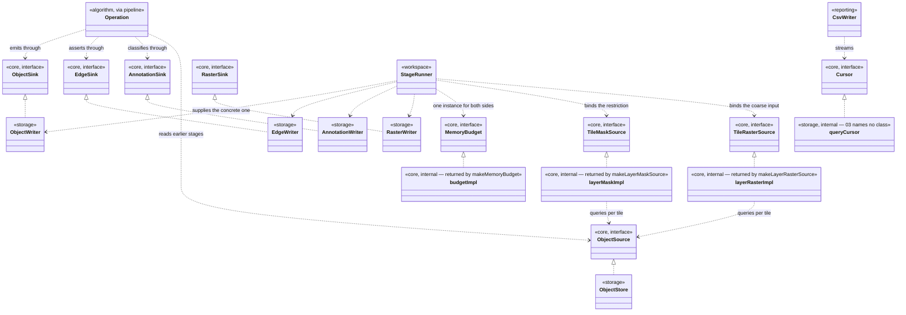

Read the two halves separately. On the left, `algorithm` talks only to the
abstractions: an operation emits into an `ObjectSink`, asserts containment
through an `EdgeSink`, classifies through an `AnnotationSink` and reads through
an `ObjectSource`, and never sees a transaction, a batch or SQLite. On the right, `storage` provides almost all the implementations, so
decision 6's batching and journal atomicity exist in exactly one place that no
algorithm author can bypass.

`StageRunner` is the join: it is the component that knows both sides, obtains
the concrete writers for its own `StageId`, and hands them to a `Pipeline` that
knows them only as interfaces.

Two abstractions are implemented in `core` itself, and only one of them is
interesting. `makeMemoryBudget` returns a budget that is counters and a
ceiling, needing nothing any other module owns — there was never anywhere else
for it to go.

`TileMaskSource` and `TileRasterSource` are the ones where the placement had
to be argued,
and the exception is principled rather than convenient. `makeLayerMaskSource`
is written entirely against `ObjectSource`, `ObjectQuery` and the rasteriser of
`01-core.md` 1.17 — all `core` — so placing it in `storage` would add a
dependency it does not have and would put a restriction out of reach of any
caller holding an `ObjectSource` that is not a store. It is the same argument
that keeps `ObjectQuery` in `core`, applied one level up: the thing that
*consumes* the abstractions can live beside them when it needs nothing else.
